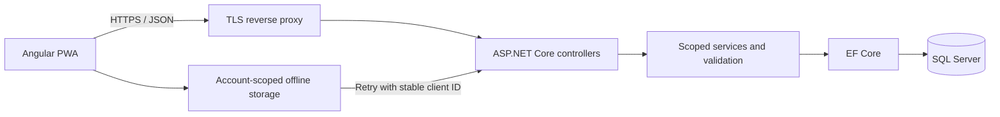
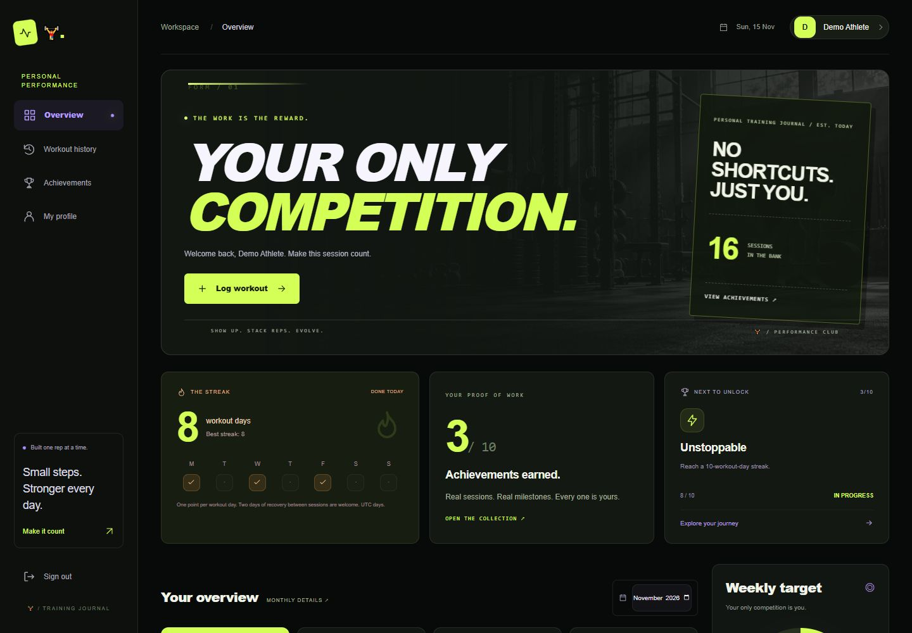
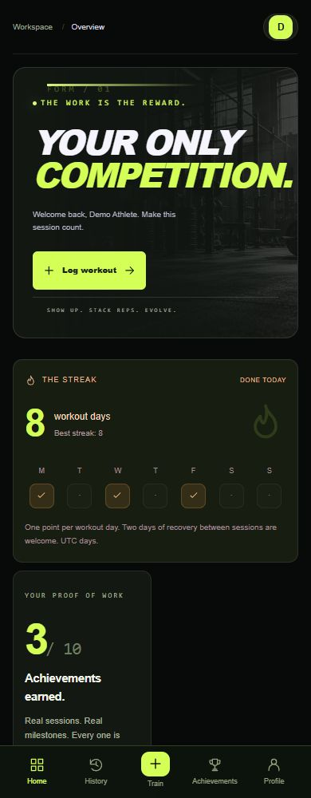
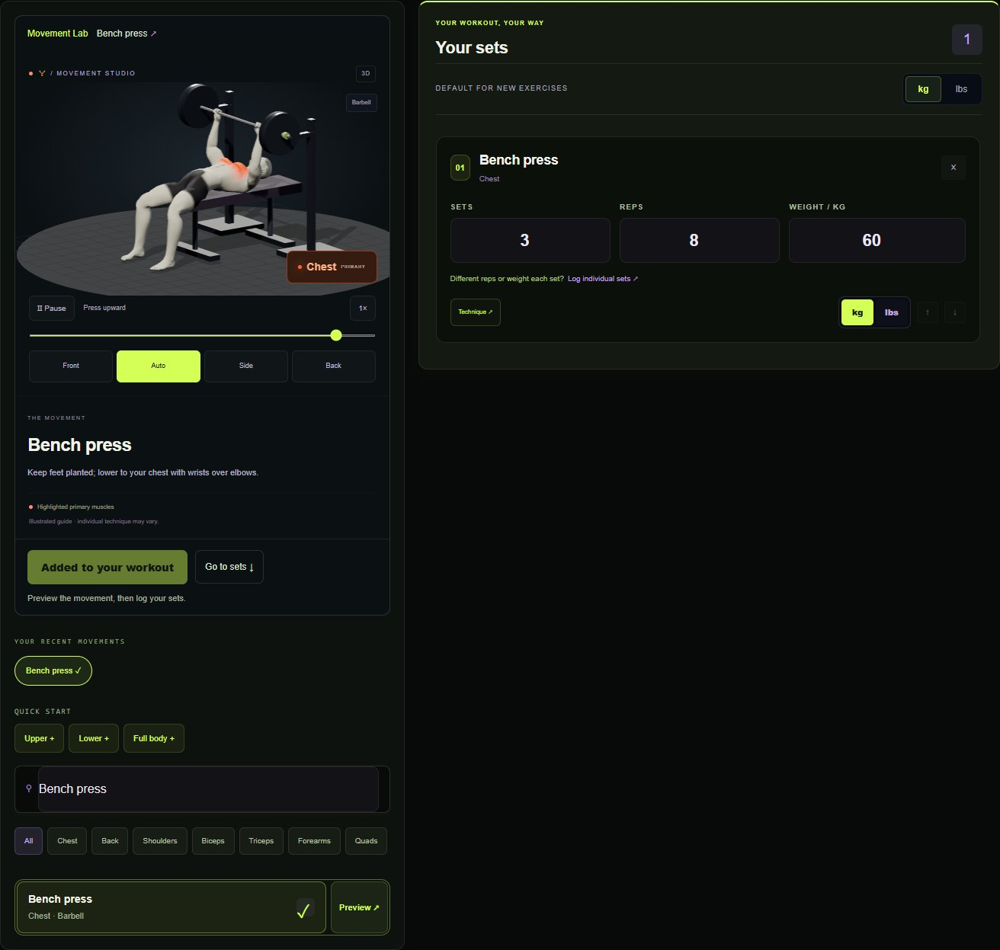

# Gym Training Tracker

[](https://github.com/markom2002/TrainingApp/actions/workflows/ci.yml)
[](https://github.com/markom2002/TrainingApp/actions/workflows/sql-server.yml)
[](https://github.com/markom2002/TrainingApp/actions/workflows/containers.yml)

A personal training journal built with **Angular 19, ASP.NET Core 8, EF Core and SQL Server**. Log workouts and individual exercises, track progress, and manage a private athlete profile. Designed for local use and portfolio demonstrations.

**Start here:** [Docker + HTTPS](docs/CONTAINERS.md) · [Isolated demo setup](docs/DEMO.md) · [SQL Server tests](docs/SQL-TESTS.md) · [API operations](docs/OPERATIONS.md)

**[Open the free interactive demo](https://markom2002.github.io/TrainingApp/)** — no registration needed. The GitHub Pages demo uses synthetic data and browser storage; it does not run the .NET API or SQL Server. See [how the static demo works](docs/PAGES-DEMO.md).

The separate server-backed demo mode creates a private visitor account with synthetic workouts when hosted; it is not publicly deployed. The personal installation keeps demo access disabled. The installed phone app uses the name 🏋️ and a lightning icon.

## Architecture



The application is a modular monolith. The server enforces ownership; offline records are scoped to the account on the device. A filtered unique SQL index prevents duplicate inserts when retries race. The backend has fast SQLite integration tests and additional real SQL Server migration/concurrency tests. CI also builds and starts both ordinary and demo Compose stacks through HTTPS.

## Portfolio walkthrough

1. Open the [public browser demo](https://markom2002.github.io/TrainingApp/) and select **Explore browser demo**, or run the [server-backed demo](docs/DEMO.md) locally.
2. Inspect mixed kg/lbs history and record individual sets.
3. Prepare offline access, save a workout without connectivity and reconnect to synchronize it.
4. Inspect the SQL Server concurrency tests and GitHub Actions reports.

The demo is intentionally separate from personal training data. Hosting and retention configuration remain deployment tasks, documented in the demo guide.

## Screenshots

Screenshots use synthetic sample data and mocked API responses; they are UI previews, not a publicly hosted deployment.



| Phone dashboard | Workout logger |
| --- | --- |
|  |  |

## Features

- **Log Workout:** searchable exercise library, recent movements, Upper/Lower/Full body starting routines and a clear session lineup. Record sets, reps or seconds and load, use individual set entries, reorder exercises and repeat an earlier workout into a new draft. Session details and optional notes are collapsible.
- **Movement Lab:** local 3D demonstrations for all 48 catalog exercises, highlighted primary muscles, automatic/front/side/back cameras, play/pause, half-speed playback and position scrubbing. Technique previews are separate from workout selection. See [movement implementation and checks](MOVEMENT-GUIDES.md).
- **Responsive interface:** dark charcoal surfaces, lime accents, readable form controls and consistent card padding on phone, tablet and desktop. Each exercise has its own kg/lbs preference.
- **Your journey:** recovery-friendly workout-day streaks, 10 achievement milestones, added-weight personal records and optional body-weight goals with weigh-in history.
- **Installable app:** Android/iPhone/desktop PWA manifest, lightning icon, install guidance, mobile navigation, cached screens and offline entry with retry-safe synchronization. See [personal phone installation](LICNA-APLIKACIJA.md) and [mobile app setup](MOBILNA-APLIKACIJA.md).
- **Dashboard:** monthly totals, previous-month comparisons, weekly activity, exercise distribution, a training calendar and progress towards a personal weekly goal.
- **History:** SQL pagination, inclusive date filters, exercise-type filtering, stable sorting and expandable exercise/set details.
- **Private profiles:** display name, bio, training focus, experience, weekly target and lifetime totals.
- **Authentication and authorization:** short-lived JWTs, rotating HttpOnly refresh cookies, automatic session restoration, a fixed 30-day session deadline, User/Admin roles and ownership checks.
- **API documentation:** Swagger examples, response schemas and ProblemDetails errors.

## Run locally

For an isolated full-stack container environment, see [Docker Compose with HTTPS](docs/CONTAINERS.md). For real-provider checks beyond the SQLite suite, see [SQL Server integration tests](docs/SQL-TESTS.md).

Requirements: .NET 8 SDK, EF CLI, Node.js 22, npm and a local SQL Server instance.

1. Configure your SQL connection in [BE/appsettings.Development.json](BE/appsettings.Development.json), or override it with `ConnectionStrings__DefaultConnection`. The checked-in signing key is for local development; `Jwt__Key` overrides it.
2. Restore dependencies and apply migrations from the repository root:

   ```powershell
   dotnet restore BE/BE.sln
   dotnet ef database update --project BE
   dotnet dev-certs https --trust
   ```

3. Start the backend:

   ```powershell
   dotnet run --project BE --launch-profile https
   ```

4. In a second terminal:

   ```powershell
   cd FE/training-app-frontend
   npm ci
   npm start
   ```

5. Open **http://localhost:4200** and register an account. The development server proxies API requests to **https://localhost:7089**; Swagger is at **https://localhost:7089/swagger**. For the installable HTTPS phone setup, use the [personal installation guide](LICNA-APLIKACIJA.md).

No application hosting account is required. Existing workouts are preserved by the profile/exercise migrations. Example Swagger credentials are sample inputs, not seeded accounts.

## Tests and builds

```powershell
# Repository root: xUnit tests against isolated SQLite databases
dotnet test BE.Tests/BE.Tests.csproj --configuration Release

# Angular directory: tests in Chrome Headless
npm run test:ci
npm run build
npm run build -- --configuration development
```

Chrome/Chromium must be installed for the frontend tests (`CHROME_BIN` can point to a custom installation). Tests do not modify the development SQL Server database.

[GitHub Actions](https://github.com/markom2002/TrainingApp/actions) runs the backend tests, Angular tests and both frontend builds on pushes and pull requests to `master`. Backend TRX reports are retained as workflow artifacts. The workflow can also be started manually.

The 3D rig check runs from the repository root after installing frontend dependencies:

```powershell
node scripts/Verify-MovementRig.mjs
```

It loads the actual athlete asset and checks 1,968 poses across 48 exercises for valid bone transforms, palm rotation continuity and fixed equipment contact. Dip-specific checks cover elbow angles, vertical forearms, elbow clearance and knee alignment.

Browser checks additionally cover login, profile editing, workout creation/history/editing, draft shortcuts, movement previews and responsive layouts at phone, tablet and desktop widths. SQLite tests complement local SQL Server migration and persistence checks.

## API

| Endpoint | Purpose | Access |
| --- | --- | --- |
| `POST /api/auth/register` | Create an account | Public |
| `POST /api/auth/login` | Issue access JWT and refresh cookie | Public |
| `POST /api/auth/refresh` | Rotate the refresh session | Refresh cookie |
| `POST /api/auth/logout` | Revoke the refresh session | Refresh cookie |
| `GET /api/auth/demo` | Report optional demo availability | Public |
| `POST /api/auth/demo` | Start an isolated sample-data session | Public, demo mode only |
| `GET /api/exercises` | Shared exercise catalog | Signed in |
| `GET, POST /api/trainings` | Paginated history / create workout | Owner |
| `GET, PUT, DELETE /api/trainings/{id}` | Read, update or delete workout | Owner |
| `GET /api/trainings/overview` | Monthly dashboard aggregates | Owner |
| `GET /api/trainings/month` | Weekly totals for a month | Owner |
| `GET, PUT /api/profile` | Read or update personal profile | Owner |
| `GET /api/admin/summary` | Application counts | Admin |
| `GET /health/live` | API process liveness | Public |
| `GET /health/ready` | Database connectivity readiness | Public |

History example:

```text
/api/trainings?page=1&pageSize=10&exerciseType=Strength&from=2026-01-01&to=2026-01-31&sortBy=durationMinutes&sortDirection=desc
```

`pageSize` is limited to 100. Supported sort fields are `trainingDate`, `durationMinutes`, `calories` and `intensity`; direction is `asc` or `desc`. Responses contain `items`, `page`, `pageSize`, `totalCount` and `totalPages`. Invalid requests return `400 application/problem+json` with field errors.

Workout requests can include:

```json
{
  "trainingVariant": "Women",
  "exercises": [
    { "exerciseId": "bench-press", "sets": 3, "reps": 10, "weightKg": 40 },
    { "exerciseId": "plank", "sets": 2, "durationSeconds": 30, "weightKg": 0 }
  ]
}
```

A workout supports up to 40 distinct exercises, 1–30 sets, 1–200 repetitions or 1–7200 seconds and 0–1000 kg of added load. Zero weight means no added load. Old session summaries remain valid without exercise entries. Full request examples are in [BE/BE.http](BE/BE.http).

## Security model

Authentication establishes identity; authorization controls access. Anonymous protected requests return **401**, a User requesting Admin statistics gets **403**, and unknown/foreign workout IDs return **404**. Admin accounts retain the same workout ownership restrictions as ordinary users.

JWTs last 15 minutes and stay in frontend memory. Refresh tokens use Secure, HttpOnly, SameSite=Strict cookies; SQL stores their SHA-256 hashes. Rotation consumes the old token and preserves the session's 30-day deadline. Logout revokes the refresh token; issued JWTs retain their remaining lifetime.

Registration always creates a User. Admin provisioning is an explicit database/operator action followed by a new login or refresh. Profile updates cannot change email, password, role or identity. New membership timestamps use UTC; weekly goals count Monday-to-Monday UTC calendar dates.

In Swagger, register and log in, then paste only `token` into **Authorize**; Swagger supplies `Bearer`. The browser manages the refresh cookie, while a refreshed JWT must be copied into Authorize again.

## Structure and optimization

- `BE/Controllers`, `DTOs`, `Services`, `Models`, `Data`: API, validation, business logic and EF persistence.
- `BE/Exercises`: stable exercise IDs and the shared catalog.
- `BE/Migrations`: versioned SQL schema changes.
- `BE.Tests`: HTTP integration and session tests.
- `FE/training-app-frontend/src/app`: standalone Angular pages, shared controls and typed services.
- `FE/training-app-frontend/public/images`: locally stored generated gym imagery and illustrative sculpture atlases.

Angular pages load on demand. The interceptor owns authentication headers and refresh retries. Monthly/profile totals are aggregated in SQL. Image assets were compressed from 7.44 MB of PNGs to **602 KB of WebP** (91.9% reduction); old wrappers, unused routes/templates and 533 overridden CSS declarations were removed. CSS and initial bundles stay within configured build budgets.

Offline use: sign in online once and wait for **Offline ready on this device**. New workouts are queued locally and synchronized when the server returns; retry IDs prevent duplicate entries. Previously fetched history is available offline. Existing server records and profile changes require a connection. See [phone and offline instructions](LICNA-APLIKACIJA.md).
